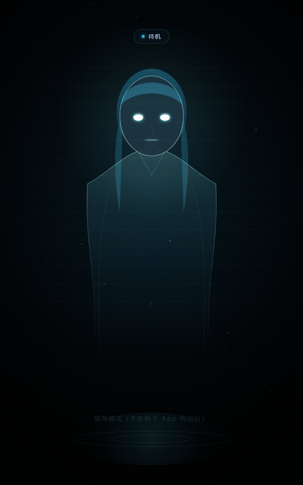
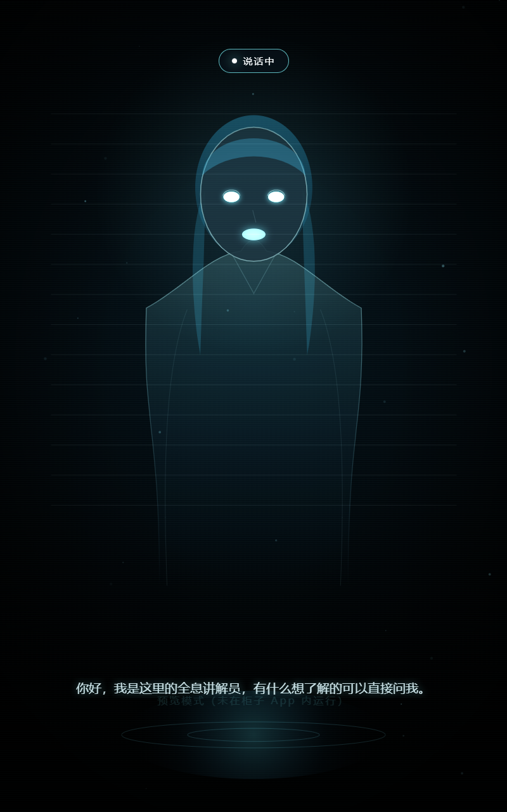

# 全息数字人（A 方案）· 柜内原生渲染 + 云端大脑

RK3568 / 4GB / Android 11 / 800×1280 竖屏 圆柱全息仓的实时对话数字人实现。

- **柜内不跑任何神经网络**：只做录音、播放、画图
- **不依赖自有服务器**：原生 OkHttp 直连阿里云百炼实时语音
- **首响约 1.4–1.6 秒**，支持随时打断
- **一个 APK** 装进柜子即可运行




---

## 一、工作原理

```
麦克风 ──► AudioRecord 16k（系统 AEC）──► 100ms 切片 ──┐
                                                       ▼
                                            OkHttp WebSocket
                                                       │
   喇叭 ◄── AudioTrack 24k ◄── PCM 音频 ◄──────────────┤
     │                                                 │
     └──► 音量包络 ──► 口型参数 ──► Canvas 立绘渲染      │
                                                       ▼
                              qwen3.8-omni-flash-realtime
                              （ASR + LLM + TTS 一条连接）
```

**为什么不用 WebView 直连**：浏览器无法设置 `Authorization` 头，官方要求必须用 header 鉴权，
走网页就得额外搭一个中转服务器；原生 WebSocket 直接设头，少一个故障点。
WebView 在本项目里只负责画形象。

---

## 二、目录结构

```
hologram-avatar/
├── app/src/main/
│   ├── java/com/holo/avatar/
│   │   ├── MainActivity.kt      # kiosk、WebView、流程编排、JS 桥
│   │   ├── RealtimeClient.kt    # 百炼 WebSocket 客户端与事件解析
│   │   ├── AudioCapture.kt      # 16k 录音 + AEC/降噪 + 分片
│   │   ├── AudioPlayer.kt       # 24k 流式播放 + 打断 + 音量包络
│   │   ├── AppConfig.kt         # 配置持久化
│   │   └── BootReceiver.kt      # 开机自启
│   ├── assets/www/
│   │   ├── index.html
│   │   ├── css/app.css
│   │   └── js/{avatar.js, app.js}
│   ├── res/…                    # 主题、布局、字符串
│   └── AndroidManifest.xml
├── build.gradle.kts
├── settings.gradle.kts
└── (本 README)
```

形象渲染全部在 `avatar.js` 的 `_geo()` 与 `_drawFigure()` 里，
改比例/换形象只动这两个地方。

---

## 三、编译

1. Android Studio（Giraffe 以上）→ **Open** → 选择 `hologram-avatar` 目录
2. 首次同步若提示缺少 `gradle-wrapper.jar`，任选其一：
   - 在项目根目录执行 `gradle wrapper --gradle-version 8.7`
   - 或用 Android Studio 提示的 “Create Gradle wrapper”
3. `Build → Build Bundle(s)/APK(s) → Build APK(s)`
4. 产物：`app/build/outputs/apk/debug/app-debug.apk`

依赖只有两个：`androidx.core:core-ktx`、`com.squareup.okhttp3:okhttp`。

---

## 四、首次配置

1. 安装 APK 并打开，会自动弹出配置面板（没有则**长按屏幕 5 秒**）
2. 填写：
   - **Workspace ID**：百炼控制台 → 业务空间 ID（形如 `llm-xxxxxxxx`）
   - **API Key**：百炼 API-KEY（`sk-` 开头）
   - **地域**：北京 / 新加坡
   - **音色**：默认 `Tina`
   - **人设**：数字人的身份、语气、回答范围
3. 点「保存并开始」，状态灯变「在听」即可说话

> 配置存本机 SharedPreferences。量产时务必改成"设备端只拿短期 token"，
> 长期 Key 不要下发到终端。

---

## 五、装机（柜体侧）

### 必做

| 项 | 操作 |
|---|---|
| 关谷歌服务 | 设置 → 应用 → 停用 Play 商店 / Play 服务 / 服务框架（4GB 机器能省 1GB 左右） |
| 动画缩放 | 开发者选项 → 窗口/过渡/动画 全部 0.5x |
| 权限 | 麦克风；`悬浮窗`（部分 ROM 开机自启需要） |
| 自启动 | ROM 的自启动白名单里加上本应用 |
| 散热 | 主板加散热片 + 5V 风扇，或柜体开百叶孔。**不做这步，15 分钟后必然掉帧** |

### Kiosk 锁死

当前实现：全屏沉浸 + 隐藏系统栏 + 常亮 + 拦截返回键 + 开机自启。

如果客户会乱按，建议再加一层（二选一）：

1. **注册成桌面**：在 `AndroidManifest` 的 Activity 里加
   ```xml
   <category android:name="android.intent.category.HOME" />
   <category android:name="android.intent.category.DEFAULT" />
   ```
   设为默认桌面后，Home 键回不到系统桌面。
2. 系统设置里开启「屏幕固定」，把本应用钉住。

---

## 六、调参

`RealtimeClient.sendSessionUpdate()` 里：

| 参数 | 默认 | 说明 |
|---|---|---|
| `silence_duration_ms` | 500 | 判停时长。调小更快但容易误切；嘈杂环境可回 600–800 |
| `threshold` | 0.5 | VAD 灵敏度。环境噪音大就调到 0.6–0.7 |
| 录音切片 | 100ms | 改小收益很小，不建议 |
| `voice` | Tina | 见百炼音色列表 |

延迟不达标时的排查顺序：网络往返 → `silence_duration_ms` → AudioTrack 缓冲。

---

## 七、排错

| 现象 | 排查 |
|---|---|
| 一直「连接中」 | Workspace ID / 地域是否对应；Key 是否有该模型权限；柜子能否访问外网 |
| 连上但不出声 | 看 logcat `HoloSpk`；AudioTrack 是否初始化失败；喇叭音量 |
| 数字人自问自答 | AEC 没生效。确认用 `VOICE_COMMUNICATION` 音源；把喇叭音量降到 70%；增大 `silence_duration_ms` |
| 说话没反应 | 麦克风权限；`HoloMic` 日志里 `aec/ns` 是否为 true；采样率是否退化成 48k |
| 画面全黑 | WebView 是否加载了 `index.html`；用 `chrome://inspect` 连上去看 console |
| 越用越卡 | 散热；`adb shell dumpsys meminfo com.holo.avatar` 看内存 |

调试：`chrome://inspect` 可以远程调试 WebView（已在代码里打开 `setWebContentsDebuggingEnabled`）。

---

## 八、当前限制

1. **形象是内置的程序化全息胸像**，不是美术资产。要换真形象，按下面「换形象」做。
2. **口型是音量驱动**，不是音素级唇形。远看没问题，特写能看出是张合。
3. **API Key 存在设备端**，单台自用可接受，量产需要 token 服务。
4. 未做离线兜底动画（断网时停在最后一个状态），建议二期补上。

### 换形象（可选）

方式一（最简单）：把美工出的分层 PNG 放进 `assets/www/avatar/`，
在 `avatar.js` 里用 `drawImage` 替换 `_drawFigure`，嘴部用 `mouth_0/1/2` 三帧按音量切换。

方式二（效果好）：接 Live2D，用 `ParamMouthOpenY` 绑定音量，帧率仍是 30fps。

方式三（最真）：接 DH_live，但需要在原生层做 ONNX/ncnn 推理，帧率有风险，建议二期。

---

## 九、开发清单（可勾选）

- [x] S1 工程骨架、全屏竖屏常亮、开机自启
- [x] S2 WebSocket 接入、session.update、事件分发、重连
- [x] S3 录音（16k+AEC）、播放（24k 流式）、打断、音量包络
- [x] S4 形象渲染（胸像、眨眼、呼吸、口型、扫描线）
- [x] S5 状态机 UI、字幕、配置面板
- [ ] S6 装机联调：散热改造、8 小时压测、验收（见方案文档第 8 节）
- [ ] 换美术形象（需素材）
- [ ] 断网兜底动画
- [ ] Key 短期化（量产前）

---

## 十、验收指标

| 指标 | 阈值 |
|---|---|
| 首响延迟 | ≤ 2.0s |
| 打断响应 | ≤ 300ms |
| 帧率 | ≥ 25fps |
| 连续运行 | 8h 无崩溃 |
| 断网恢复 | ≤ 15s |
| 回声自激 | 70% 音量下不自问自答 |

---

## 十一、云端打包（GitHub Actions，无需装 Android Studio）

仓库里已带好 `.github/workflows/android.yml`，推上去就会自动出 APK。

### 步骤

1. 在 GitHub 新建一个空仓库（Private 也行，Actions 免费额度 2000 分钟/月，一次构建约 3–5 分钟）
2. 在本目录执行：

```bash
git remote add origin https://github.com/<你的用户名>/<仓库名>.git
git push -u origin main
```

3. 打开仓库 → **Actions** → 左侧 `Build APK` → 看到绿色对勾
4. 进入那次运行 → 页面底部 **Artifacts** → 下载 `hologram-avatar-debug.zip`
5. 解压得到 `app-debug.apk`，装到柜子即可

> 注意：Artifact 必须登录 GitHub 才能下载；链接 90 天后过期。

### 构建失败怎么查

点进失败的步骤看日志，常见几类：

| 日志关键词 | 原因 | 处理 |
|---|---|---|
| `Failed to find target with hash string 'android-34'` | SDK 包没装上 | workflow 里的 sdkmanager 那步失败，重跑一次 |
| `This project uses AndroidX…` | 缺少 `android.useAndroidX` | 已写在 `gradle.properties`，确认没有漏传 |
| `$'\r': command not found` | 文件被转成 CRLF | 已用 `.gitattributes` 锁定 LF |
| `Unsupported class file major version` | JDK 版本不对 | workflow 固定 JDK 17，别改 |
| `Could not resolve com.squareup.okhttp3` | 网络问题 | 重跑；或加阿里云 Maven 镜像 |

### 安全提醒

- 仓库里**没有任何密钥**：API Key 是装机后在 App 的配置页里填的，不进代码
- `local.properties`（本机 SDK 路径）已在 `.gitignore` 里，不会上传

